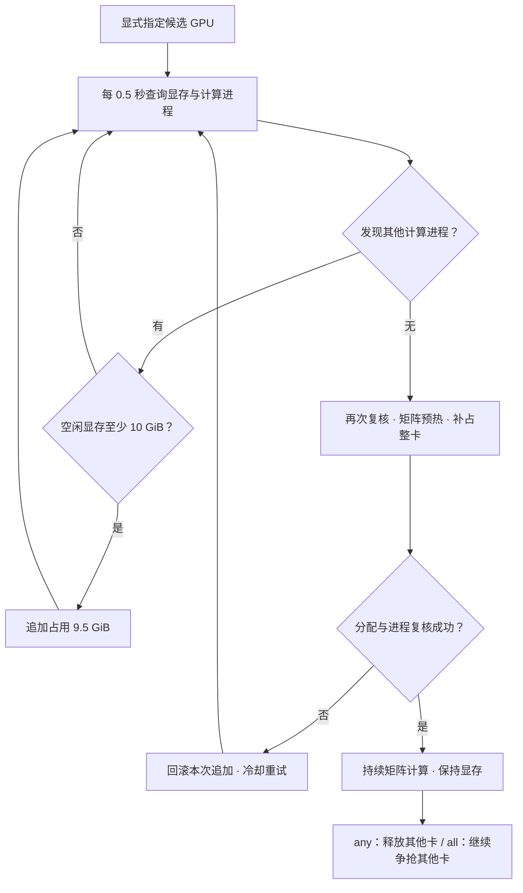

<div align="center">

# ⚡ llama

**一个命令，固定占显存 · 渐进抢整卡**


面向 Linux / NVIDIA GPU 的轻量显存占用工具。  
用环境变量选卡，用一个参数指定显存，其余策略集中在脚本开头。

[快速开始](#快速开始) · [两种模式](#两种模式) · [抢卡策略](#抢卡策略) · [配置](#配置) · [测试](#测试)

</div>

---

## 快速开始

### 下载并安装

需要 Linux、NVIDIA 驱动和 Python 3.9+。**已有 CUDA 版 PyTorch 环境时，先激活该环境即可，无需重复安装依赖。**

```bash
git clone https://github.com/HaiFengLoveStudy/llama.git
cd llama
chmod +x llama
```

没有安装 PyTorch 时，再运行：

```bash
python3 -m pip install -r requirements.txt
```

运行 `python3 -c 'import torch; print(torch.cuda.is_available())'`，输出 `True` 即可使用。如果输出 `False`，请按 [PyTorch 安装说明](https://pytorch.org/get-started/locally/) 安装与驱动兼容的 CUDA 版本。

### 在 0 号卡上运行

```bash
CUDA_VISIBLE_DEVICES=0 ./llama
```

默认逐步占用空闲显存，取得整卡后持续计算；按 **Ctrl+C** 停止并释放显存。更多用法如下。

### ① 固定占用 30 GiB

```bash
CUDA_VISIBLE_DEVICES=0 ./llama --memory 30
```

支持小数，例如 `--memory 0.5`。必须只指定一张卡；显存不足会报错并释放本次分配，不自动等待。此模式只保持显存，不运行矩阵计算。

### ② 在多张候选卡中抢到一张

```bash
CUDA_VISIBLE_DEVICES=0,1,2 ./llama
```

默认 `CLAIM_MODE = "any"`。每张候选卡逐步占用空余显存；一张卡成功进入整卡计算后，其余候选卡全部释放。

也支持完整 GPU UUID：

```bash
CUDA_VISIBLE_DEVICES=GPU-xxxxxxxx-xxxx-xxxx-xxxx-xxxxxxxxxxxx ./llama
```

必须显式设置 `CUDA_VISIBLE_DEVICES`。数字表示 `nvidia-smi` 显示的物理 GPU 编号；UUID 必须完整，不支持 MIG 实例。

### ③ 指定的卡全部占住

修改 `llama` 文件开头：

```python
CLAIM_MODE = "all"
```

然后照常运行：

```bash
CUDA_VISIBLE_DEVICES=0,1,2 ./llama
```

每张卡独立取得整卡并持续计算，已取得的卡保持运行，其余卡继续等待。配置在启动时读取；修改文件不会改变已运行的实例。

### ④ 释放某张卡

启动日志会显示**主控 PID**。在另一个终端中运行：

```bash
./llama --release 1 --pid 12345
```

将 `12345` 替换为日志中的主控 PID。这里的 `1` 始终是物理 GPU 编号；释放后该卡从本次监测列表移除，不会重新抢占。其他卡继续运行，最后一张卡释放后主控退出。

此接口用于默认抢卡模式。固定 `--memory` 模式通过 Ctrl+C 或 `kill PID` 结束。

### ⑤ 停止整个实例

前台运行按 **Ctrl+C**，或使用日志给出的命令：

```bash
kill 12345
```

主控请求自己的工作进程退出；超时后仅终止自身工作进程，释放它们持有的显存。

## 两种模式

| | 固定显存占用 | 渐进式抢卡 |
| :--- | :--- | :--- |
| **启动方式** | `llama --memory 30` | `llama` |
| **选卡** | 单张 GPU | 一张或多张候选 GPU |
| **显存行为** | 分配指定容量并保持 | 持续追加空余显存，条件满足后取得整卡 |
| **计算行为** | 不执行计算循环 | 整卡取得后持续 FP16 矩阵计算 |
| **结束方式** | Ctrl+C / `kill PID` | Ctrl+C / `kill PID` / 单卡释放 / 配置时限 |

容量统一使用 **GiB**，1 GiB = 1024³ 字节。固定模式的指定容量是张量容量，进程实际显存还包含 CUDA 上下文等开销。

<details>
<summary><b>可选：安装为直接可用的 llama 命令</b></summary>

在仓库目录运行：

```bash
mkdir -p "$HOME/.local/bin"
ln -s "$PWD/llama" "$HOME/.local/bin/llama"
export PATH="$HOME/.local/bin:$PATH"
```

如需持久生效，将 `export PATH` 这一行加入 shell 配置。符号链接指向本仓库，移动仓库后需要更新链接。脚本使用当前 `PATH` 中的 `python3`，因此运行前应激活安装了 CUDA PyTorch 的环境。

</details>

## 抢卡策略



- **快速确认**：一轮未发现其他计算进程，就尝试取得整卡；分配前后仍复核进程列表。
- **容量自适应**：按实际显存容量减去预留空间分配，默认预留 1 GiB，不绑定 80 GiB 显卡。
- **持续计算**：取得整卡后循环 FP16 矩阵乘法，提高计算利用率；实际利用率受硬件与采样影响，不保证恒为 100%。
- **异常回滚**：追加或整卡准备失败时撤销本次新增分配，保留尚存的此前占位，再等待重试。
- **实例互斥**：同一用户的抢卡实例通过 GPU UUID 文件锁避免重复监测；固定显存模式不使用此锁。抢卡时任一指定卡已被本用户另一实例锁定，本次启动会报错退出。

“抢卡”指占用逐步释放的空间，不会终止其他用户的进程，也不提供系统级独占。进程复核与分配之间仍存在竞争窗口；取得整卡后不再阻止其他程序启动。请在你获准使用的 GPU 上运行。

## 配置

所有策略都集中在 `llama` 文件开头，命令行保持简洁。

| 常量 | 默认值 | 含义 |
| :--- | :--- | :--- |
| `CLAIM_MODE` | `"any"` | `any` 取得一张；`all` 取得全部指定卡 |
| `POLL_SECONDS` | `0.5` | 主控查询间隔，秒；不含系统调用耗时 |
| `FREE_THRESHOLD_GIB` | `10.0` | 追加分配所需的最少空闲显存 |
| `ALLOCATION_STEP_GIB` | `9.5` | 每轮追加容量 |
| `EXCLUSIVE_SAMPLES` | `1` | 连续无其他计算进程的确认次数 |
| `RESERVE_GIB` | `1.0` | 整卡阶段预留空间 |
| `COMPUTE_HOURS` | `None` | 每张卡的计算时限；`None` 为不限时 |
| `MATRIX_SIZE` | `8192` | FP16 矩阵边长 |
| `BLOCK_MIB` | `256` | 显存分配块大小，MiB |
| `RETRY_SECONDS` | `5.0` | 分配失败后的冷却时间 |
| `STARTUP_TIMEOUT` | `180.0` | 工作进程启动或分配回应超时 |
| `STATUS_LOG_SECONDS` | `30.0` | 等待状态日志间隔 |
| `COMPUTE_LOG_SECONDS` | `60.0` | 计算状态日志间隔 |
| `STOP_TIMEOUT` | `15.0` | 工作进程正常停止等待时间 |

例如，全部抢占、每张卡取得后计算 12 小时：

```python
CLAIM_MODE = "all"
COMPUTE_HOURS = 12.0
```

到期的卡释放并移出列表，其他卡继续运行。小显存设备可适当调小 `MATRIX_SIZE`、追加阈值和步长；矩阵预热需要额外空间。

## 命令参考

```text
llama                              渐进抢卡，策略由常量决定
llama --memory GiB                 单卡固定显存占用
llama --release GPU --pid PID      释放指定主控管理的一张物理卡
llama --help                       查看帮助
```

`--memory` 与释放参数互斥。释放命令无需设置 `CUDA_VISIBLE_DEVICES`。

## 测试

```bash
python3 -B -m unittest discover -s tests -v
```

测试使用模拟 GPU/PyTorch，并验证真实 Unix socket 释放请求；不调用 NVIDIA 查询、不初始化 CUDA、不启动训练。覆盖两种抢卡策略、参数校验、固定分配、失败回滚、无限期计算和退出清理。模拟测试不代替真实 GPU 压力验证。

```text
.
├── llama                 # 唯一命令入口与全部配置
├── README.md
├── requirements.txt         # PyTorch
└── tests/
    └── test_llama.py      # CPU 模拟回归测试
```
